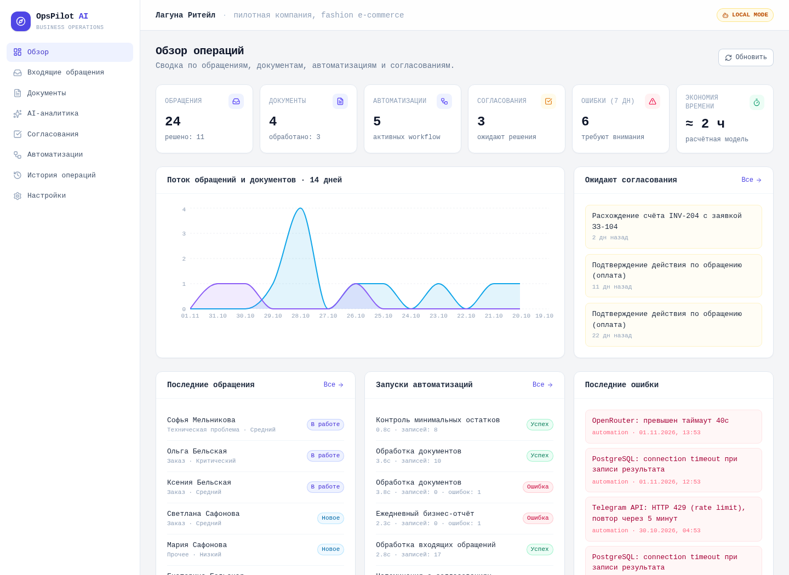

# OpsPilot — ИИ в бизнес-процессах под контролем человека

**Портфолио Mikhail V. · автоматизация процессов и внедрение ИИ**

Как превратить обращение или счёт в управляемый процесс: получить данные, подготовить решение, проверить его, передать сотруднику и сохранить историю. OpsPilot показывает этот цикл на вымышленной компании «Лагуна Ритейл».

[Связаться в Telegram](https://t.me/grelok) · [Резюме](https://cv.myvelum.com/) · [Рабочий стенд](https://ops.myvelum.com)

Стенд требует входа. Для собеседования или обсуждения внедрения напишите мне: проведём демонстрацию без передачи административных паролей. Скриншоты и материалы ниже доступны без регистрации.

## Что здесь можно оценить

| Бизнес-задача | Автоматизация | Контроль человеком | Наблюдаемый результат |
| --- | --- | --- | --- |
| Обращения теряются между сотрудниками | Приём, дедупликация, классификация, черновик ответа, задача | Согласование финансовых и критичных действий | Обращение получает статус, ответственного и историю |
| Счёт расходится с заявкой | Извлечение полей, проверка структуры и арифметики | Сотрудник видит ожидаемые и фактические значения | Согласование или возврат в работу с записью решения |
| Для отчёта нужно собирать данные вручную | Вопрос → разрешённый тип отчёта → проверенные параметры | Человек интерпретирует результат и выбирает действие | Ответ с источником и периодом; модель не исполняет SQL |

Это демонстрационный проект, а не подтверждённое внедрение у клиента. Данные вымышлены. Экономия времени в интерфейсе — расчётная модель, не измеренный эффект. Согласование не выполняет банковский платёж и не отправляет ответ клиенту автоматически.

## Моя роль

Я поставил задачи для OpsPilot и управлял разработкой с помощью разных LLM, контролируя результат. Код приложения создан с использованием ИИ. Мой фокус — постановка бизнес-задач, организация процесса разработки и проверка того, что решение соответствует задаче. Я не заявляю, что весь код написан мной вручную.

На собеседовании предлагаю разобрать путь от задачи до работающего сценария, границы автоматизации, необходимость контроля человеком и проверку результатов работы LLM. Технические проверки ниже характеризуют проект; сами по себе они не подтверждают опыт ручного программирования или коммерческих внедрений.

## Посмотреть за пять минут

1. [Бизнес-кейс](docs/CASE_STUDY.md): проблема, сценарии, критерии приёмки.
2. [Демонстрация](docs/DEMO.md): два экрана и последовательность показа.
3. [Архитектура](docs/ARCHITECTURE.md): компоненты, границы ИИ и компромиссы.
4. [Фрагменты реализации](samples/README.md): защита от повторного решения и проверка конкуренции.
5. [Проверки и ограничения](docs/VERIFICATION.md): что проверено и что ещё требует работы.

**Стек:** Next.js / TypeScript · FastAPI / Python · PostgreSQL · n8n · Docker Compose.

Полная реализация хранится отдельно с ограниченным доступом. Здесь опубликованы материалы для оценки проекта и небольшие фрагменты кода; комплект развёртывания не предоставляется.

[Условия использования](LICENSE.md) · [Лицензионная история и сторонние компоненты](docs/RIGHTS.md)

**Найм и обсуждение внедрения:** Mikhail V., [@grelok](https://t.me/grelok).
