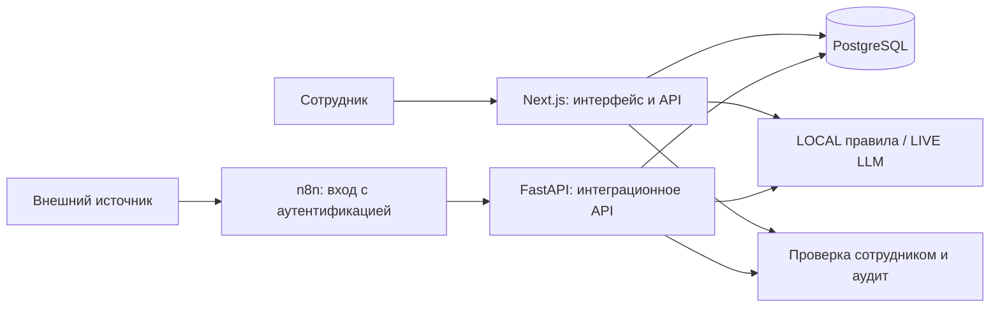

# Архитектура и принятые компромиссы

Браузер работает с Next.js API; n8n обращается к FastAPI. Это два прикладных API с общей БД, а не последовательная цепочка браузер → FastAPI. Полная схема данных и интеграционные workflows не публикуются.

| Решение | Зачем | Ограничение |
| --- | --- | --- |
| LOCAL и LIVE разделены | Проверять сценарии без оплаты LLM и явно показывать происхождение ответа | LOCAL не доказывает качество внешней модели |
| Разрешённые типы аналитических запросов | Ограничить действия модели и проверить параметры | Новый отчёт требует разработки |
| Решение, изменение сущности и аудит в транзакции | Исключить частично сохранённый результат | Нужно тестировать конкуренцию на реальной БД |
| Актуальные права пользователя проверяются по БД | Учитывать отзыв сессии и смену роли | Дополнительное обращение к БД |
| Два API над общей БД | Поддержать UI и интеграции | Дублирование правил; нужны согласованные изменения и контрактные проверки |
| Уведомление после сохранения | Сбой доставки не отменяет бизнес-решение | Без outbox доставка не гарантирована |

Стек полной реализации: Next.js/React/TypeScript, FastAPI/Pydantic/SQLAlchemy, PostgreSQL, Drizzle/Alembic, n8n, Docker Compose и Nginx. Сборка интерфейса проверялась без доступа к рабочей БД и секретам.

Для промышленной нагрузки потребуются фоновые воркеры, надёжная очередь уведомлений, проверка масштабирования и отдельная оценка безопасности. Здесь нет OCR для сканов, готовых CRM/ERP-коннекторов или банковского исполнения.

[К портфолио](../README.md)
