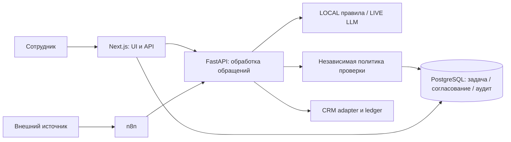

# Архитектура и компромиссы

Обработка обращений принадлежит одному FastAPI-сервису: UI и n8n получают одинаковые бизнес-эффекты. Claim выполняется короткой транзакцией; внешний LLM-вызов не удерживает блокировку строки; результат, задача, согласование и аудит сохраняются атомарно.

| Решение | Зачем | Ограничение |
| --- | --- | --- |
| LOCAL/LIVE разделены | Воспроизводимое демо и явное происхождение ответа | LOCAL не подтверждает качество внешней модели |
| Независимые правила ручного контроля | Ошибочная категория модели не отключает все ограничения | Эвристики не гарантируют распознавание любого риска |
| Один обработчик обращений | Устранить разницу UI/n8n | Документы и решения ещё имеют две реализации |
| Условное изменение согласования и транзакция | Одно решение и согласованный аудит | Нужны проверки конкуренции на PostgreSQL |
| CRM ledger и сверка после неопределённого write | Уменьшить риск дублей | Не распределённая гарантия exactly-once; нужен ручной разбор зависших случаев |
| Разрешённые аналитические intents | Ограничить действия LLM | Новый отчёт требует реализации |
| Фиксированная историческая схема миграции | Новые модели не создаются раньше своей ревизии | Изменения схемы оформляются отдельными миграциями |

Пакетные задания ожидают фактического завершения; ошибки записей дают `failed`. Глобальный таймаут ожидания не выдаётся за отмену работающей задачи. Для промышленной нагрузки нужны воркеры, восстановление после остановки, outbox и дополнительные проверки безопасности.

Стек: Next.js/React/TypeScript, FastAPI/Pydantic/SQLAlchemy, PostgreSQL, Drizzle/Alembic, n8n, Docker Compose/Nginx. Нет OCR для сканов или банковского исполнения.
