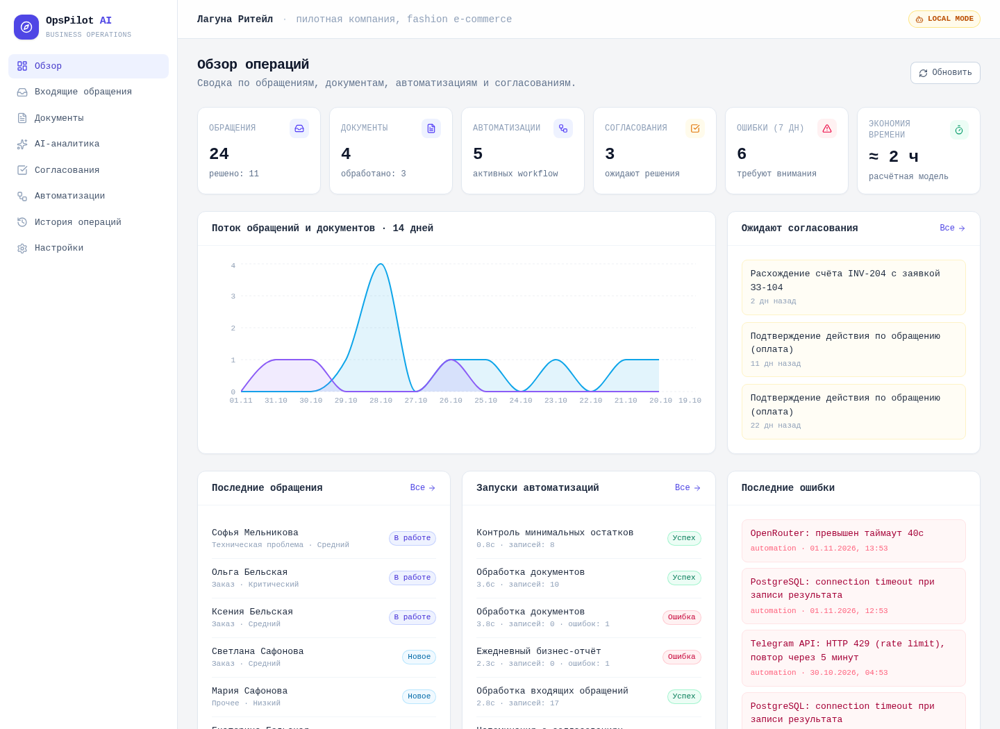
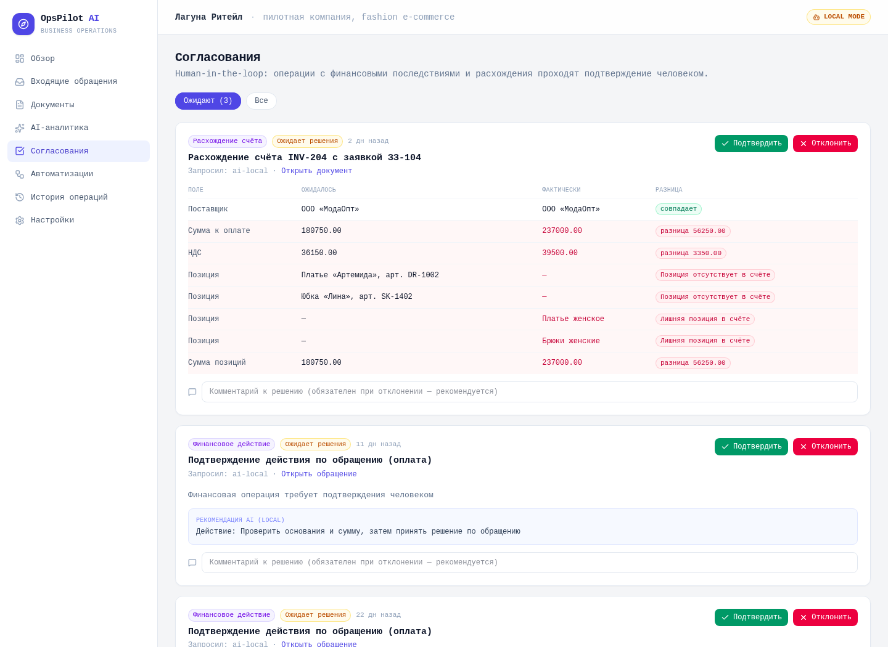

# Демонстрация для собеседования

Изображения получены ранее с работающего приложения в изолированном LOCAL-контуре. Данные, названия компаний, суммы и события синтетические. Надпись «пилотная компания» внутри интерфейса означает вымышленный пример, не реального заказчика. Ошибки внешних сервисов на обзоре — демонстрационные записи, не доказательство реальных отправок.

## 1. Обзор: что требует внимания

Показать входящие обращения, ожидание согласований и историю запусков. Объяснить отличие расчётной экономии времени от измеренного результата. Метрики относятся к демонстрационной выборке.

## 2. Согласование: где человек принимает решение

Сравнить ожидаемую и фактическую сумму, НДС и позиции счёта. Показать, какие сведения нужны сотруднику для решения. Утверждение меняет состояние документа в системе, но не отправляет платёж.

## План живого показа, 5–7 минут

1. Объяснить бизнес-задачу и происхождение данных.
2. Показать путь обращения от получения до задачи и истории.
3. Разобрать документ с расхождением и точку ручного контроля.
4. В отдельном демонстрационном контуре показать решение, аудит и запрет решения для роли operator.
5. Объяснить LOCAL/LIVE, пределы автоматизации и следующие шаги пилота.

[Рабочий стенд](https://ops.myvelum.com) требует авторизации. Для показа — [Mikhail V., @grelok](https://t.me/grelok). Административные учётные данные не публикуются. Скриншоты позволяют оценить интерфейс без доступа к стенду. Изменяющие данные демонстрации проводятся отдельно от рабочего контура.

[К портфолио](../README.md)
