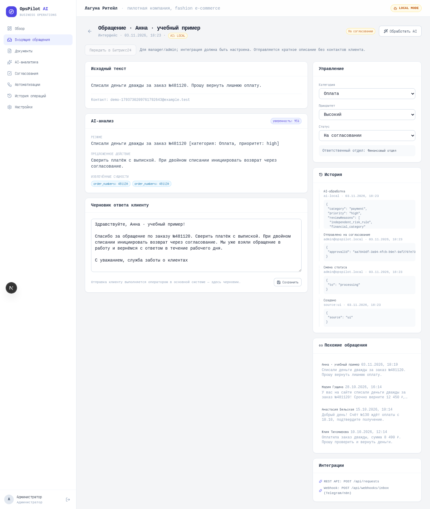
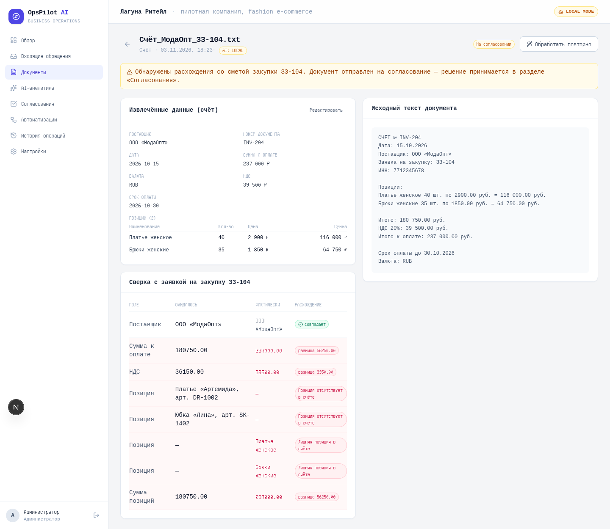

# Демо без регистрации

[Открыть запись, 1 минута 59 секунд](media/opspilot-demo.webm). Видео показывает реальные действия в изолированном приложении и содержит поясняющие титры. Весь набор данных синтетический. LOCAL означает правила; CRM — локальный HTTP-сервер контракта, не реальный портал Битрикс24.

## Что происходит в записи

| Этап | Что оценивать |
| --- | --- |
| Обзор | Статусы и исключения; экономия времени обозначена как расчётная |
| Новое обращение о двойном списании | Входные данные, классификация, контекст ручной проверки |
| Согласование | Ответственный принимает решение; отдельная проверка подтверждает 403 для operator |
| Передача в CRM | Явный шаг, состояние доставки, повтор с тем же внешним ID |
| Счёт с расхождением | Извлечённые поля, ожидаемые/фактические значения и очередь проверки |

## Экраны работающего приложения

[Список документов без NaN](screenshots/documents.png) · [Передача в CRM](screenshots/crm.png)

## Для живого собеседования

Начать с бизнес-проблемы и показать один маршрут целиком. Затем разобрать отказ ИИ, повтор источника, запрещённое решение и потерянный ответ CRM. Завершить результатами оценки, ошибочными случаями и планом пилота.

[Рабочий стенд](https://ops.myvelum.com) требует авторизации и не обновляется автоматически вместе с этими материалами. Доступ и живой показ можно обсудить [с Mikhail V.](https://t.me/grelok). Для первичной оценки достаточно записи и материалов этого репозитория.
