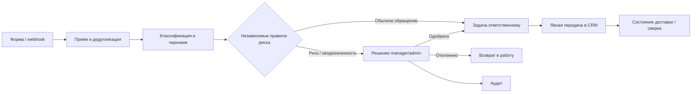

# Процесс: обращение клиента от входа до контролируемого результата

Учебная модель торговой компании. Описанная организация процесса — проектное предложение, не обследование реального заказчика.

## AS-IS: исходная гипотеза

Клиент пишет в форму или мессенджер. Оператор вручную переносит текст, определяет отдел, создаёт задачу и уточняет спорные случаи у руководителя. Повторные сообщения могут превращаться в отдельные задачи; контекст решения остаётся в переписке.

До пилота это надо подтвердить интервью и наблюдением: каналы, объём, роли, SLA, причины возврата в работу, способы хранения контактов и ограничения внешних ИИ.

## TO-BE

Задача создаётся при обработке, включая обращения, ожидающие проверки. До решения такие обращения не экспортируются в CRM. Одобрение меняет внутренний статус; отправка ответа, платёж и возврат средств не выполняются. CRM-кнопка создаёт лид с кратким описанием и внешним ID, а не банковское действие или CRM-задачу.

| Участник | Ответственность |
| --- | --- |
| Владелец процесса | Утвердить правила маршрутизации, SLA и критерии пилота |
| Оператор | Проверить данные, доработать черновик, обработать назначенную задачу |
| Руководитель | Принять решение по исключению и указать основание |
| Автоматизатор | Настроить поля, правила, интеграцию, проверки, диагностику и инструкцию восстановления |
| Администратор | Управлять доступами, секретами, резервным копированием и окружением |

## Исключения и ожидаемое поведение

| Событие | Поведение |
| --- | --- |
| Повторная доставка в пределах принятой политики дедупликации | Возвращается исходный ID; новая независимая задача не создаётся |
| Невалидный ответ / таймаут ИИ | Обращение получает ошибку; допускается осознанный повтор |
| Финансовые признаки в тексте при ошибочной категории модели | Независимое правило направляет обращение человеку |
| Неизвестная категория / низкая самооценка модели | Ручная проверка; самооценка не трактуется как измеренная точность |
| Параллельное решение | Один итог, второй запрос получает конфликт |
| CRM отказала при поиске | Доставка `failed`; можно повторить поиск |
| Ответ создания CRM потерялся | `uncertain`; сначала поиск по внешнему ID, без слепого повторного создания |
| Процесс завершился аварийно в `processing` / `sending` | Требуется диагностика; автоматическое восстановление воркером пока отсутствует |
| Ошибка уведомления | Уже принятое решение сохраняется; гарантированная доставка требует outbox |

## Приёмка и пилот

1. Обращение из UI и интеграции проходит один обработчик FastAPI.
2. Есть задача, статус, причина ручной проверки и история.
3. Operator не принимает решение; повтор решения не проходит.
4. Счёт с расхождением хранит извлечённые поля и сравнение, а не остаётся в `processing`.
5. Повтор CRM не создаёт новую запись; неопределённый исход виден сотруднику.
6. На слепой размеченной выборке измерены качество маршрутизации и пропуски опасных случаев.

Порог качества должен согласовать владелец процесса **до** оценки пилота. Текущий синтетический набор — набор разработки, не основание для автоматических финансовых действий.

## Как измерить эффект

Сравнить одинаковые или сопоставимые случаи в ручном и автоматизированном процессе. Отдельно записывать активное время сотрудника, полное время до решения, число исправлений и время обработки исключений.

`Чистая экономия часов = N × (ручное время − время проверки) / 60 − время исключений`.

`Оценка эффекта = экономия часов × полная стоимость часа − расходы ИИ/CRM/хостинга/поддержки`.

Без исходных замеров формула является моделью, не результатом внедрения. Создан шаблон [PILOT_MEASUREMENTS.csv](PILOT_MEASUREMENTS.csv), пустые значения заполняются по наблюдениям, а не генерируются.
